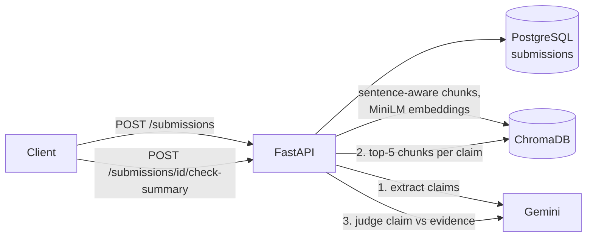

# Corrobo

[](https://github.com/smibrahimali1423/Corrobo/actions/workflows/ci.yml)

Corrobo checks whether an AI-generated summary is supported by the document it summarises.

You submit a source document and a summary of it. Corrobo splits the summary into atomic claims,
retrieves the most relevant passages of the source for each claim, and asks an LLM judge whether
the evidence **supports**, **contradicts**, or **can't verify** each claim.

## How it works



1. **Chunking** (`chunking.py`): the source is split into sentences with NLTK Punkt, using a custom
   abbreviation list so clinical shorthand (`p.o.`, `b.i.d.`, `i.v.`) doesn't end a sentence.
   Sentences are packed into chunks of at most 200 tokens (MiniLM tokenizer) with a one-sentence
   overlap; a single sentence longer than the limit is split by token offsets.
2. **Embedding and storage** (`embeddings.py`): chunks are embedded with
   `sentence-transformers/all-MiniLM-L6-v2` and stored in a persistent ChromaDB collection, tagged
   with the submission id so retrieval never crosses submissions.
3. **Claim extraction** (`claims.py`): Gemini returns a list of standalone claims, constrained to a
   JSON schema.
4. **Judgement** (`judge.py`): for each claim, the top 5 chunks are retrieved and Gemini returns a
   schema-constrained verdict (`SUPPORTED`, `CONTRADICTED` or `UNVERIFIABLE`) with a one-sentence
   reason, using only the retrieved evidence.

Each claim is judged in isolation: if the API call for one claim fails, that claim comes back with
an `ERROR` verdict and the rest of the batch is still returned.

| Layer | Tech |
|---|---|
| API | FastAPI, Pydantic, SQLAlchemy 2 |
| Data | PostgreSQL 16, ChromaDB |
| Retrieval | sentence-transformers (all-MiniLM-L6-v2), NLTK Punkt |
| LLM | Google Gemini (`google-genai`, structured output) |
| Ops | Docker, docker-compose, GitHub Actions, PyTest |

## API

| Method | Path | What it does |
|---|---|---|
| `GET` | `/` | Health check |
| `POST` | `/submissions` | Store a source document and summary; chunk and embed the source |
| `GET` | `/submissions` | List submissions |
| `POST` | `/submissions/{id}/check` | Judge one claim (`{"claim": "..."}`) against that submission |
| `POST` | `/submissions/{id}/check-summary` | Extract every claim from the summary and judge each one |

Interactive docs are at <http://localhost:8000/docs> once the API is running.

### Example

```bash
curl -X POST localhost:8000/submissions \
  -H "Content-Type: application/json" \
  -d '{"source_document": "The patient was started on metformin 500 mg b.i.d. for type 2 diabetes. Blood pressure was normal.",
       "summary": "The patient takes metformin twice daily and has high blood pressure."}'

curl -X POST localhost:8000/submissions/1/check-summary
```

The response is one result per claim, in this shape (the verdicts and reasons come from the model):

```json
[
  {
    "claim": "The patient takes metformin twice daily.",
    "verdict": "SUPPORTED",
    "reason": "...",
    "evidence": ["The patient was started on metformin 500 mg b.i.d. for type 2 diabetes. ..."]
  },
  {
    "claim": "The patient has high blood pressure.",
    "verdict": "CONTRADICTED",
    "reason": "...",
    "evidence": ["..."]
  }
]
```

## Running it

### With Docker

```bash
cp .env.example .env    # add your GEMINI_API_KEY
docker compose up --build
```

The API is on <http://localhost:8000>; Postgres is exposed on port 5544. The image downloads the
NLTK data and the embedding model at build time, so containers start without network calls, and
the API runs as a non-root user.

### Locally

Requires Python 3.10+ and a running PostgreSQL.

```bash
python -m venv .venv && source .venv/bin/activate
pip install -r requirements-dev.txt
cp .env.example .env    # set DATABASE_URL and GEMINI_API_KEY
uvicorn main:app --reload
```

## Tests

```bash
pytest
```

The suite (14 tests) covers chunking, claim extraction, the judge and the API endpoints. Calls to
Gemini, ChromaDB and the embedding model are mocked, so the tests run without an API key.
CI runs the suite on every push and pull request against a real PostgreSQL service container.

## Status and next steps

Working locally and in CI; not deployed yet. Planned: user accounts, a small web UI, deployment,
and an evaluation on a labelled set of summaries to measure how often the verdicts are right.
