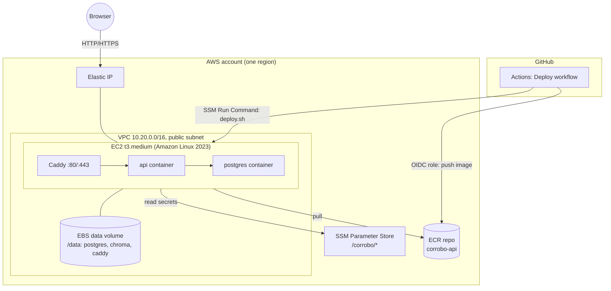

# Deploying Corrobo to AWS

This guide takes you from an empty AWS account to Corrobo live at a URL. Everything that needs
your AWS account, the AWS console, or your GitHub settings is marked **(manual)**. Nothing in
this repo contains AWS credentials, and none are needed to *test* the infrastructure code
(`terraform test` mocks AWS).

## What gets created



| Resource | Why |
|---|---|
| VPC, subnet, IGW, route table | An isolated network, so nothing depends on the account's default VPC |
| Security group | Ports **80 and 443 only**. No SSH: shell access goes through SSM Session Manager |
| EC2 instance | Runs `docker compose` with postgres, api and caddy. IMDSv2 enforced, encrypted disks |
| EBS data volume | Postgres, Chroma and TLS data live here, so they survive instance replacement. `prevent_destroy` guards it |
| Elastic IP | A stable public IP to point DNS at |
| ECR repository | Stores the API image; scan on push; keeps the last 10 images |
| Instance IAM role | SSM agent, ECR pull, and read access to `/corrobo/*` parameters only |
| GitHub OIDC provider and role | Lets the deploy workflow push to ECR and run `deploy.sh`, with no stored AWS keys |

**Rough cost:** a t3.medium is about $30/month on demand in us-east-1. Add about $4/month for
50 GB of gp3, and the Elastic IP's public IPv4 charge (about $3.60/month). Gemini usage is billed
separately by Google. A t3.small (2 GB) can work but is tight with torch loaded; set
`instance_type` to change it.

## Prerequisites

- An AWS account you can administer. **(manual)**
- AWS CLI v2, configured locally with credentials for that account (`aws configure` or SSO).
  **(manual)**
- Terraform ≥ 1.6.
- Optional: a domain whose DNS you control, for HTTPS.
- Optional: a Gemini API key from Google AI Studio. Without one the app runs with checks
  disabled.

## Step 1: Create the secrets in SSM Parameter Store (manual)

Secrets are created by you, not by Terraform, so they never end up in Terraform state or in git.
Pick your region and keep it consistent throughout:

```bash
export AWS_REGION=us-east-1

aws ssm put-parameter --region $AWS_REGION --type SecureString \
  --name /corrobo/postgres_password --value "$(openssl rand -hex 24)"

aws ssm put-parameter --region $AWS_REGION --type SecureString \
  --name /corrobo/jwt_secret --value "$(openssl rand -hex 32)"

# Optional: without it the app runs with LLM checks disabled.
aws ssm put-parameter --region $AWS_REGION --type SecureString \
  --name /corrobo/gemini_api_key --value "PASTE-YOUR-GEMINI-KEY"
```

> `postgres_password` is applied when the database is **first** initialized. Changing it later
> also requires `ALTER USER corrobo PASSWORD '…'` inside the db container. `jwt_secret` and
> `gemini_api_key` can be rotated at any time: update the parameter and redeploy (step 6).
> Rotating `jwt_secret` signs everyone out.

## Step 2: Provision the infrastructure

```bash
cd infra/terraform
cp terraform.tfvars.example terraform.tfvars
# edit: aws_region, github_repository ("<owner>/<repo>"), optional domain_name

terraform init
terraform plan          # review: about 20 resources
terraform apply
```

Note the outputs: `public_ip`, `app_url`, `instance_id`, `ecr_repository_url`,
`github_deploy_role_arn`.

Commit the generated `.terraform.lock.hcl`; it pins provider checksums. Keep `terraform.tfstate`
safe and out of git (it's gitignored). For a team, move state to S3 using `backend.tf.example`.

> **"EntityAlreadyExists" for the OIDC provider?** Your account already has a GitHub OIDC
> provider. Set `create_github_oidc_provider = false` and apply again.

On first boot the instance installs Docker, formats and mounts the data volume, and writes
`/opt/corrobo/{docker-compose.prod.yml,Caddyfile,deploy.sh,deploy.conf}`. It then tries a
first deploy, which is *expected* to fail because ECR doesn't have an image yet. The next steps
fix that.

## Step 3: Point your domain at the server (manual, optional)

If you set `domain_name`, create a DNS **A record** for it pointing at the `public_ip` output.
Caddy obtains a Let's Encrypt certificate automatically on the first request once DNS resolves.
Port 80 must stay open for the challenge.

Without a domain, the app is served over plain HTTP at `http://<public_ip>`. That's fine for a
demo, but passwords then cross the network unencrypted, so use a domain for anything real.

## Step 4: Configure GitHub for deploys (manual)

In the GitHub repo, go to **Settings → Secrets and variables → Actions → Variables** and add
these *variables* (none of them are secrets):

| Variable | Value |
|---|---|
| `AWS_REGION` | e.g. `us-east-1` |
| `AWS_DEPLOY_ROLE_ARN` | `github_deploy_role_arn` output |
| `ECR_REPOSITORY_URL` | `ecr_repository_url` output |
| `EC2_INSTANCE_ID` | `instance_id` output |
| `DEPLOY_ON_PUSH` | optional: `true` to deploy on every push to `main` |

Then create an environment named **production** (Settings → Environments). Optionally add
required reviewers there so deploys need approval.

The IAM role only trusts workflows running on the **main** branch of the repo you configured.

## Step 5: First deploy

In GitHub, go to **Actions → Deploy → Run workflow** on `main`. The workflow:

1. assumes the AWS role via OIDC,
2. builds the Docker image (frontend and API, with model weights baked in) and pushes `:<sha>`
   and `:latest` to ECR,
3. runs `/opt/corrobo/deploy.sh <sha>` on the instance via SSM Run Command, which:
   - renders `/opt/corrobo/.env` from SSM parameters (root-only permissions),
   - `docker compose pull && up -d` (the API container runs `alembic upgrade head` on start),
   - waits for the API healthcheck.

Then open `app_url`. `GET /api/health` should show `"database": true` and
`"llm_configured": true` if you set the Gemini key.

To deploy **without GitHub Actions**, build and push from your machine, then run the script
through Session Manager:

```bash
ECR=<ecr_repository_url>
aws ecr get-login-password --region $AWS_REGION | docker login --username AWS --password-stdin ${ECR%%/*}
docker build -t $ECR:manual . && docker push $ECR:manual
aws ssm start-session --target <instance_id>      # needs the Session Manager plugin
sudo /opt/corrobo/deploy.sh manual
```

**Optional demo account:** to seed the demo user in production, run this once on the instance,
with a password of your choosing (the default is public in this repo):

```bash
sudo docker compose -f /opt/corrobo/docker-compose.prod.yml exec \
  -e DEMO_PASSWORD='choose-something-private' api python seed.py
```

## Step 6: Day-2 operations

| Task | How |
|---|---|
| Shell on the server | `aws ssm start-session --target <instance_id>` |
| Logs | `sudo docker compose -f /opt/corrobo/docker-compose.prod.yml logs -f api` |
| Redeploy / roll back | Run the Deploy workflow, or `sudo /opt/corrobo/deploy.sh <older-sha>` |
| Rotate a secret | `aws ssm put-parameter --overwrite …`, then redeploy |
| Bootstrap log | `/var/log/corrobo-bootstrap.log` |
| DB backup | `sudo docker compose -f /opt/corrobo/docker-compose.prod.yml exec db pg_dump -U corrobo corrobo > backup.sql`, or schedule EBS snapshots with AWS Backup / Data Lifecycle Manager **(manual, recommended)** |
| Bigger instance | Change `instance_type`, then `terraform apply` (the data volume is kept) |
| Tear down | `terraform destroy`. The data volume is protected: remove `prevent_destroy` in `compute.tf` first if you really mean to delete the data |

## Manual steps checklist

- [ ] AWS account and local AWS CLI credentials
- [ ] SSM parameters: `postgres_password`, `jwt_secret`, and optionally `gemini_api_key`
- [ ] `terraform.tfvars` filled in, then `terraform apply`
- [ ] Commit `.terraform.lock.hcl`; optionally set up the remote state backend
- [ ] Optional: DNS A record for `domain_name`
- [ ] GitHub variables and the `production` environment
- [ ] Run the Deploy workflow
- [ ] Recommended: EBS snapshot schedule, an AWS Budgets alert, and a CloudWatch alarm on
      instance status checks

## Troubleshooting

- **Deploy step fails with "Missing required SSM parameter"**: step 1 was skipped, or used a
  different region or prefix.
- **SSM command never runs / instance not in Fleet Manager**: the SSM agent needs outbound
  internet access (it has it via the IGW) and the instance role. Wait about 2 minutes after
  boot and check `/var/log/amazon/ssm/`.
- **HTTPS certificate not issued**: DNS isn't pointing at the EIP yet, or port 80 is blocked.
  Check `docker compose … logs caddy`.
- **API unhealthy right after deploy**: check `docker compose … logs api`. A failed migration or
  a bad `DATABASE_URL` shows up there.
- **Docker Compose plugin download failed during bootstrap**: set `docker_compose_version` to a
  current release tag from github.com/docker/compose/releases and re-apply (this replaces the
  instance; the data volume is kept).
